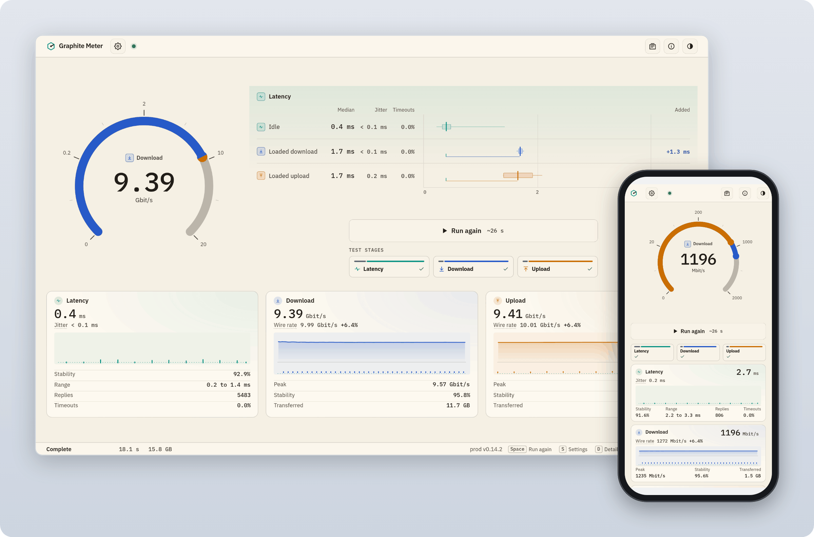
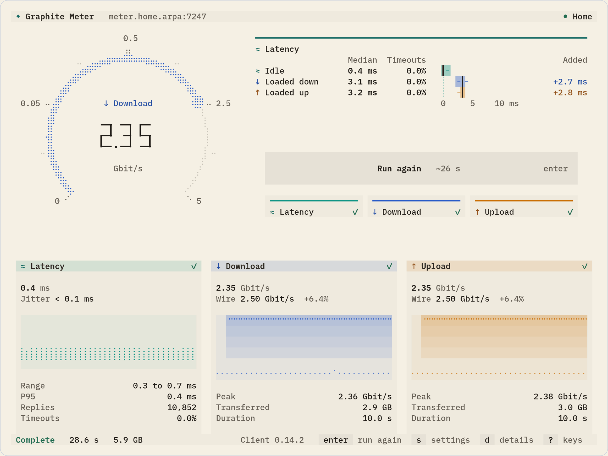
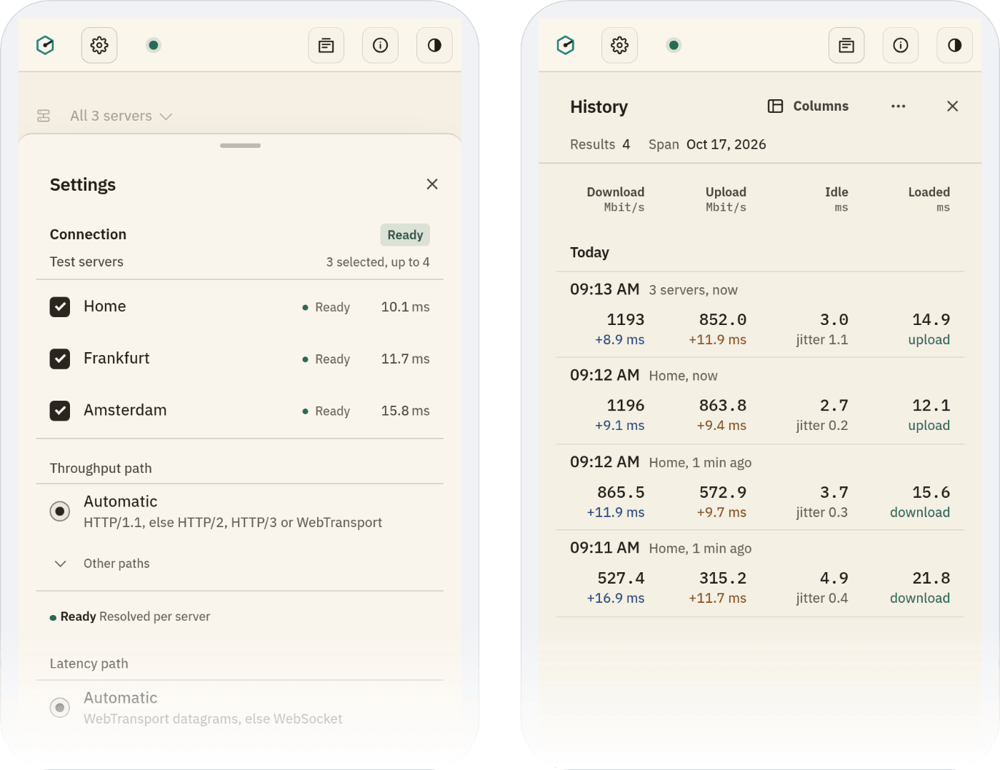

<div align="center">


# Graphite Meter

A self-hosted speed and latency test, in one container or one binary, for the browser and the terminal.

[](https://github.com/zR-JB/graphite-meter/actions/workflows/ci.yml)
[](https://github.com/zR-JB/graphite-meter/releases/latest)
[](https://github.com/zR-JB/graphite-meter/pkgs/container/graphite-meter)
[](LICENSE)

<picture>
  <source media="(prefers-color-scheme: dark)" srcset="docs/assets/hero-dark.png">
  
</picture>

<sub>Browser app 0.13.1 in Chrome on a desktop and a phone.</sub>

</div>

## Why Graphite Meter

- **Receiver-timed.** The receiver times every transfer: your browser times downloads and the server times uploads, so bytes still queued never count.
- **Latency under load.** Idle and loaded latency are measured separately, each with median, P95, jitter and timeouts, so you see exactly how much a busy line adds.
- **Honest gaps.** Missing data shows as missing, never as zero, and no result is graded.
- **Every web transport.** Throughput over HTTP/1.1, HTTP/2, HTTP/3 or WebTransport, latency over WebSocket or WebTransport, picked automatically or by hand.
- **Several servers.** One run measures one to four servers on one schedule and shows them combined or one at a time.
- **Terminal client.** `graphite-meter-client` runs the same test and reports the same numbers in the same words as the browser.
- **Built for fast links.** Profile-optimized release builds and a server that spreads every protocol, HTTP/3 included, across all CPU cores.
- **Smooth while it measures.** Timing runs in background workers, so the page stays responsive and rates update live; animation steps aside when your system asks for reduced motion.
- **Adjustable.** Choose servers, paths, stage times and warmup, early finish, probe cadence, stream count, units and History; light, dark or automatic theme.
- **Self-hosted.** One image for amd64 and arm64, or the same static binary on its own for Linux, with no database. Password or OIDC sign-in is optional.
- **Private.** The server stores no results and connects out only to an OIDC provider; the page loads nothing from a third party.

[How each result is measured](docs/MEASUREMENTS.md).

### No proxy needed

Graphite Meter serves the app and every measurement path itself, so a test runs straight from the browser to the server.

- **Every protocol arrives as sent.** Behind a reverse proxy the server sees a second hop, usually clear HTTP/1.1, whatever the browser used; direct listeners measure HTTP/2, HTTP/3 and WebTransport end to end.
- **Uploads are timed where they land.** No proxy buffers or limits the request body before the server counts its bytes.
- **Nothing to tune.** No upstream timeouts, buffering rules or forwarded headers to get right.

It still runs behind nginx, Caddy or Traefik when you need one; see [reverse proxies](docs/DEPLOYMENT.md#reverse-proxies).

## Quick start

```sh
docker run -d --name graphite-meter --restart unless-stopped -p 7246:7246 ghcr.io/zr-jb/graphite-meter:latest
```

Open `http://SERVER_IP:7246`. Over plain HTTP the test uses HTTP/1.1 and WebSocket; HTTP/2, HTTP/3 and WebTransport need TLS
from the [native listeners](docs/DEPLOYMENT.md#native-listeners) or a [reverse proxy](docs/DEPLOYMENT.md#reverse-proxies).

## Terminal

<div align="center">

<picture>
  <source media="(prefers-color-scheme: dark)" srcset="docs/assets/terminal-dark.png">
  
</picture>

<sub>Terminal client 0.13.1.</sub>

</div>

Every [release](https://github.com/zR-JB/graphite-meter/releases) attaches the client for Linux and Windows, each on
amd64 and arm64. Point it at your server, or add `--report` to run one test without the console:

```sh
graphite-meter-client --url http://192.168.1.20:7246
graphite-meter-client --url https://meter.example.net --server frankfurt --server amsterdam --report
```

## Settings and History

<div align="center">

<picture>
  <source media="(prefers-color-scheme: dark)" srcset="docs/assets/phones-dark.png">
  
</picture>

<sub>Browser app 0.13.1 in Chrome on a phone.</sub>

</div>

History keeps up to 2,000 results in the browser and shows the columns you choose.

## Documentation

| Page                                            | Covers                                                                                           |
| ----------------------------------------------- | ------------------------------------------------------------------------------------------------ |
| [Deployment](docs/DEPLOYMENT.md)                | Compose, Quadlet, TLS, reverse proxies, sign-in, the server catalog, troubleshooting. |
| [Server reference](docs/REFERENCE.md)           | Every server command, setting and limit, and the log format.                                     |
| [Terminal client](docs/TERMINAL.md)             | Installing, flags, keys, report mode and exit codes.                                             |
| [Measurement definitions](docs/MEASUREMENTS.md) | What each result means and how it is computed.                                                   |
| [Development](docs/DEVELOPMENT.md)              | Building, testing, the workspace and releasing.                                                  |

## Contributing

`mise run setup` installs the toolchain, `mise run dev` serves a development build on port 7246, and
`mise run check` runs the gate a pull request must pass. The [development guide](docs/DEVELOPMENT.md) has the rest.

## License

Copyright 2026 zR-JB, AGPL-3.0-or-later; see [LICENSE](LICENSE) and [COPYRIGHT](COPYRIGHT). Every image and archive
ships its third-party notices: the browser shows them in its legal view, the server and client archives carry them as files, and
the image keeps them under `/usr/share/licenses/graphite-meter/`. Every release attaches the third-party source.
