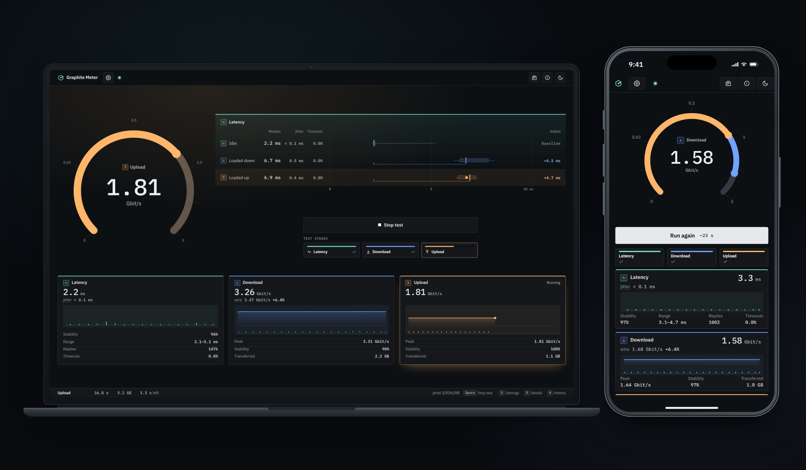

<div align="center">

# Graphite Meter

Self-hosted speed and latency testing for your own network, from a browser or a terminal.

[](https://github.com/zR-JB/graphite-meter/actions/workflows/ci.yml) [](https://github.com/zR-JB/graphite-meter/releases) [](https://github.com/zR-JB/graphite-meter/pkgs/container/graphite-meter) [](LICENSE)



<sub>Real tests over shaped home-network paths · <a href="docs/SCREENSHOTS.md">screenshots</a></sub>

</div>

Graphite Meter measures download, upload and latency between your device and a server you run: across a LAN, over a
VPN or to a remote host, up to multi-gigabit links. One container serves the browser app, and a native terminal
client tests the same server.

## Features

- Receiver-timed throughput: downloads count the bytes the client consumed, uploads the bytes and time at the
  server's receiver, so a sender's queue never inflates a result. Download, upload and bidirectional stages.
- Latency under load: idle and loaded latency stay separate populations per stage, with median, P95, jitter and
  timeouts. Added latency is the loaded median minus the idle median.
- One to four test servers per test: an operator lists other servers in a server catalog, and a test runs them on
  one schedule, together or shown one at a time. A server that drops out leaves a Partial result with its reason.
- Your choice of path: throughput and latency paths are chosen independently over HTTP/1.1, HTTP/2, HTTP/3,
  WebSocket and WebTransport, or automatically. Details show what the browser and the server each observed.
- Browser and terminal: a responsive web app for phones and desktops, and a native client for Linux and Windows.
- Self-hosted: one static binary in a small container, no database. Optional password or OIDC sign-in protects the
  app and every measurement route.
- History on your device: the browser can keep up to 2,000 results locally; the server stores none.

## Quick start

```sh
docker run -d --name graphite-meter --restart unless-stopped \
  -p 7246:7246 ghcr.io/zr-jb/graphite-meter:latest
```

Open <http://localhost:7246>, or `http://SERVER_IP:7246` from another device, and start a test. Without
configuration the server offers HTTP/1.1 throughput and WebSocket latency.

HTTP/2, HTTP/3 and WebTransport need TLS: see [native listeners](docs/DEPLOYMENT.md#native-listeners). Other setups:
[Docker Compose](docs/DEPLOYMENT.md#docker-compose), [reverse proxies](docs/DEPLOYMENT.md#reverse-proxies),
[sign-in](docs/DEPLOYMENT.md#authentication), [Podman Quadlet](container/quadlet/README.md) and a
[Tailscale sidecar](container/quadlet/tailscale-sidecar/README.md).

## Terminal client


Download the archive for your platform from [Releases](https://github.com/zR-JB/graphite-meter/releases):
`graphite-meter-client_X.Y.Z_linux_amd64.tar.gz`, `graphite-meter-client_X.Y.Z_linux_arm64.tar.gz` or
`graphite-meter-client_X.Y.Z_windows_amd64.zip`.

```sh
./graphite-meter-client --url http://192.168.1.20:7246
./graphite-meter-client --url https://meter.example --server frankfurt --server amsterdam --report
```

Without a terminal, or with `--report`, it runs one test, prints the report and sets its exit status from the
outcome. On a server with sign-in, you approve the client's code in your browser; the client never sees the
password. The [terminal client guide](docs/TERMINAL.md) covers flags, keys and exit codes.

## Documentation

- [Deployment and configuration](docs/DEPLOYMENT.md): containers, TLS, proxies, sign-in and every setting.
- [Test servers](docs/SERVERS.md): the server catalog and tests across several servers.
- [Terminal client](docs/TERMINAL.md): install, flags, keys, report mode and environment.
- [Measurement definitions](docs/MEASUREMENTS.md): what each result measures and how.
- [Development](docs/DEVELOPMENT.md): building, testing and releasing.
- Contracts: [discovery](api/discovery.md), [uploads](api/upload.md) and [latency](api/wire.md).

## Contributing

Set up a checkout with `mise run setup`, start it with `mise run dev`, and run `mise run check` before submitting a
change. The [development guide](docs/DEVELOPMENT.md) has the details.

## License

Copyright © 2026 zR-JB. Licensed under AGPL-3.0-or-later; see [LICENSE](LICENSE) and [COPYRIGHT](COPYRIGHT).
Third-party notices ship in the browser's legal view, in the client archives and under
`/usr/share/licenses/graphite-meter/` in the container.
