# A look around Graphite Meter

[Project overview](../README.md) · [Quick deployment](DEPLOYMENT.md#fast-local-deployment) · [What the numbers mean](MEASUREMENTS.md)

Every browser capture is a real run of a production build after version 0.11.1. The servers are local, each behind
a link shaper that models one client's path into a 10 GbE home network: a laptop on Wi-Fi 7 for the desktop views and
the README's hero, and a phone on Wi-Fi 6E. The figures are what the meter measured over those paths, not a benchmark
of a network.

## The completed test

The dial carries the run's headline and every stage's result on one ring; the latency lanes set idle and loaded
latency side by side with what each load added; one card per stage, under its key, keeps the stage's graph with
the latency its load caused underneath.

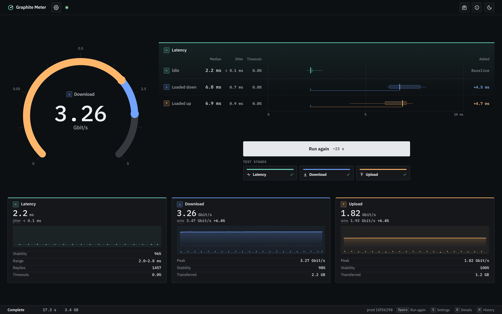

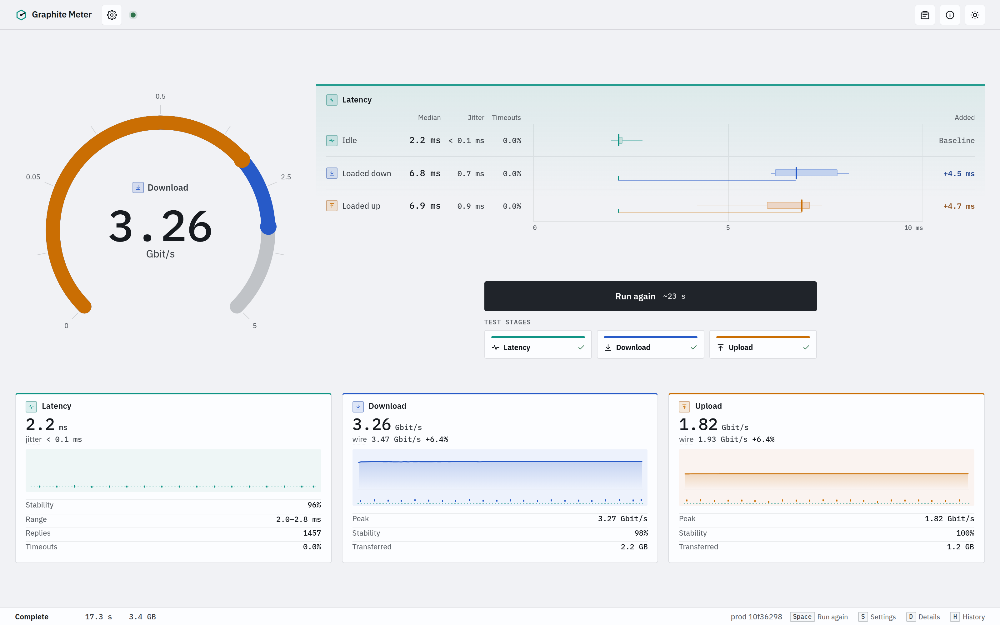

## Settings and Details

Settings choose servers, connection paths, stage timings and display options. Details name the tested server and
the paths a run used, separating what the browser observed from what reached the server. On a wide desktop both dock
beside the meter.

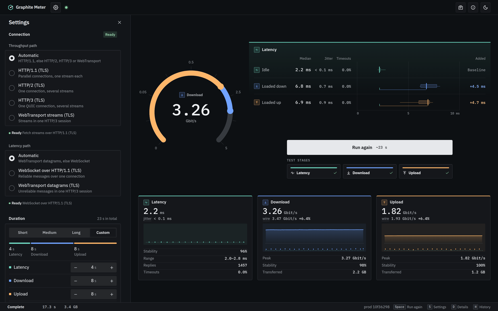

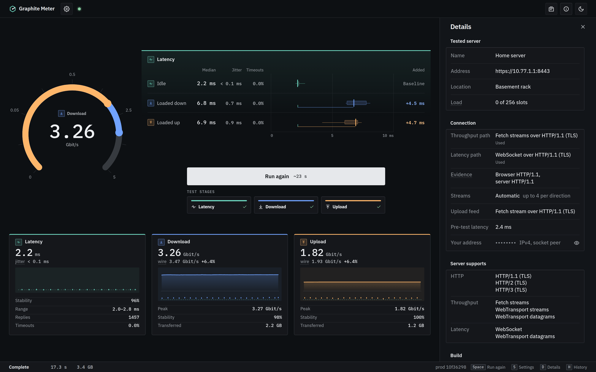

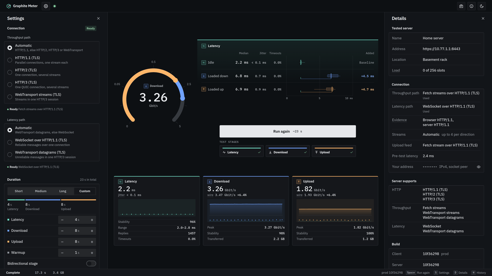

## Several servers

Up to four servers share one run, their speeds added together, and each is probed for latency. The latency lanes
show one server at a time, named in their head, where another can be chosen at any moment, mid-run included; the
selector over the dial shows the results of all servers or one once the run is done, and Details inspects any
server whenever you like. A server that leaves marks its stage **Partial**, and the card names the reason.

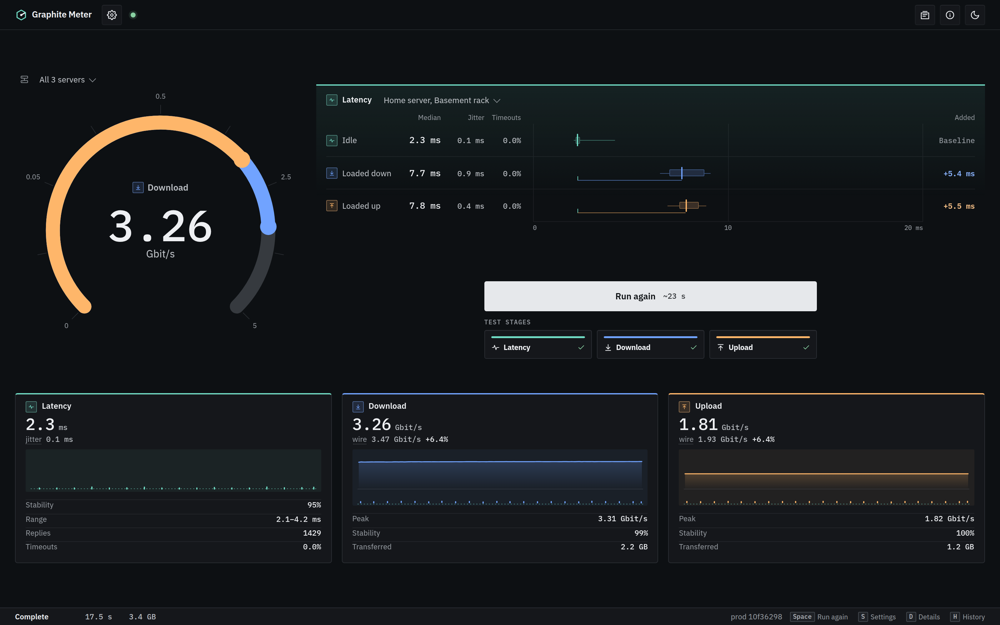

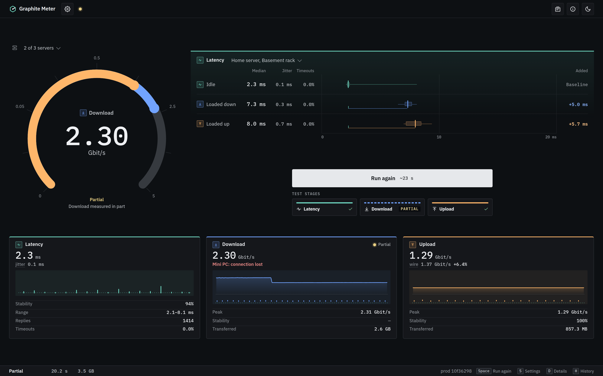

## History on your device

Saved results are grouped by day. Each row shows the rates with the latency their load added, and a result opens with
the live meter's stage and latency cards, its server selector and the evidence sections.

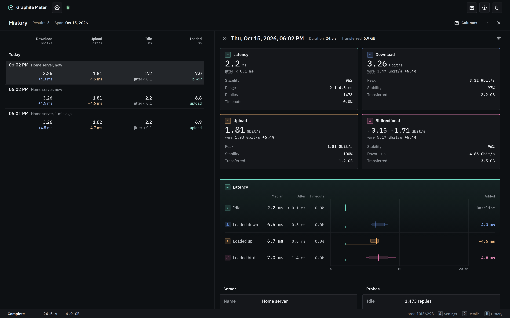

## Phone

A phone gives the dial most of its width, then the key, the stages and a compact card per stage with every fact,
the latency lanes under them; nothing overlaps whatever the stages, servers or settings. Turned on its side, it keeps
the dial in view while the rest scrolls beside it, and a sheet follows the finger and leaves on a flick.

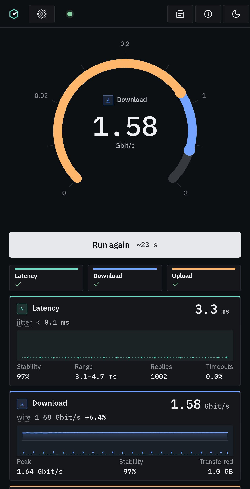
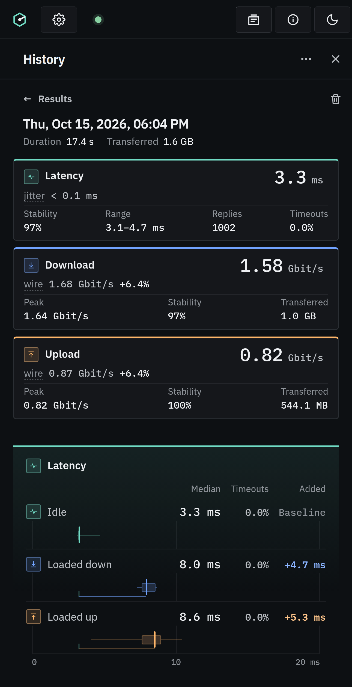

## Signing in

A private server asks for its operator password on a faceplate: the dial at rest behind a lock, the host the page was
reached at, and the password with a key to show it. While the server checks it, the ring sweeps as a stage's would.

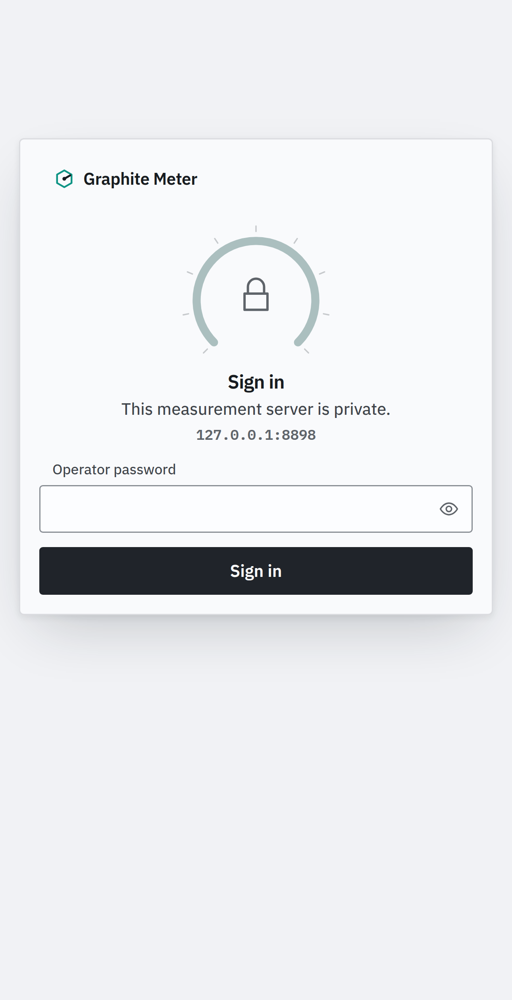
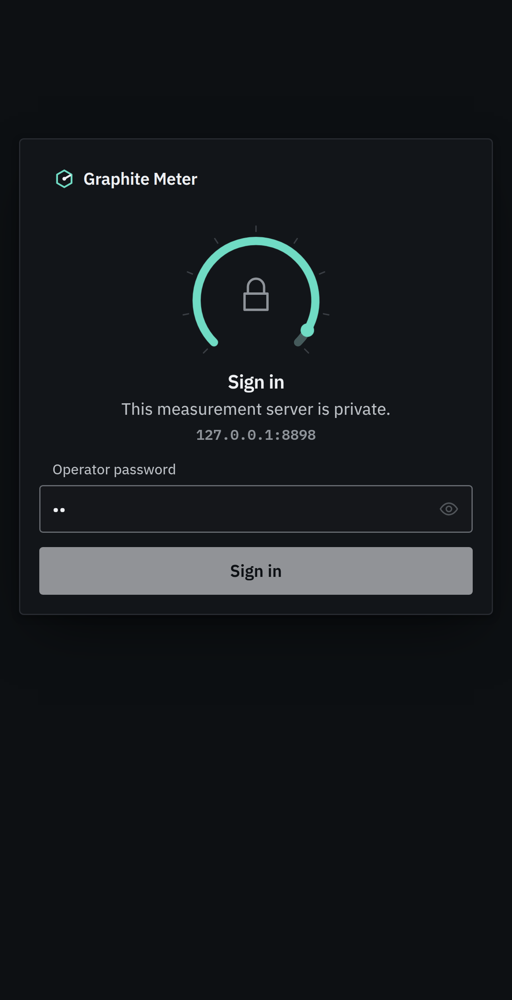

## Terminal client

The terminal client runs the same measurement against the same servers on one console: the dial, the latency lanes,
the run key over its stage chips, and a card per stage.

## How these were captured

The browser captures come from a production build of revision 10f36298 in headless Chrome 154, at 1600 × 1000
(workspace 1920 × 1080) with 2× density and 430 × 839 with 3× for the phone, with stages of 4 s latency, 8 s download
and upload, 6 s bidirectional and a 1 s warmup. The laptop's path carries 3.4 Gbit/s down and 1.9 Gbit/s up with
1 ms of one-way delay, the phone's 1.65 and 0.86 Gbit/s with 1.5 ms; each queues up to 4 ms of data, so latency
under load comes from real queueing. The three servers of the multi-server test each have their own path, together
about the laptop's, and the partial test stops one server during download. The sign-in pages come from a local
server with password sign-in. The hero sets the laptop's upload stage and the phone's result in device outlines.

The terminal capture is a development build of the client with its default stages, 120 × 40 cells in VTE at 2×,
against a local server behind a shaping proxy of 2.35 Gbit/s each way with 1.2 ms of one-way delay.

To measure your own network, follow [deployment and configuration](DEPLOYMENT.md).
