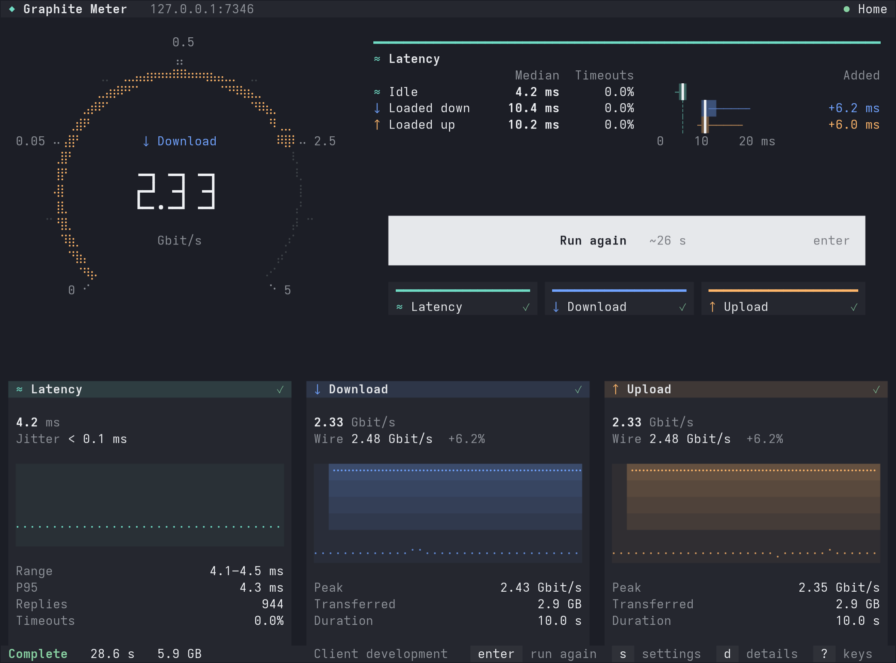

# Terminal client

`graphite-meter-client` runs the same measurement as the browser against the same server: one to four test servers,
independently chosen throughput and latency paths, idle and loaded latency, and receiver-timed throughput. It has an
interactive console and a report mode for scripts.

[Project overview](../README.md) · [Deployment](DEPLOYMENT.md) · [Measurement definitions](MEASUREMENTS.md)



## Install

Each [release](https://github.com/zR-JB/graphite-meter/releases) attaches one archive per platform:

| Platform       | Archive                                          |
| -------------- | ------------------------------------------------ |
| Linux, amd64   | `graphite-meter-client_X.Y.Z_linux_amd64.tar.gz` |
| Linux, arm64   | `graphite-meter-client_X.Y.Z_linux_arm64.tar.gz` |
| Windows, amd64 | `graphite-meter-client_X.Y.Z_windows_amd64.zip`  |

The Linux builds are static. Each archive holds the executable (`graphite-meter-client`, or
`graphite-meter-client.exe` on Windows) and its license notices, which `--legal` also prints. To build it from
source, see the [development guide](DEVELOPMENT.md#commands).

```sh
tar -xzf graphite-meter-client_X.Y.Z_linux_amd64.tar.gz
./graphite-meter-client_X.Y.Z_linux_amd64/graphite-meter-client --url http://192.168.1.20:7246
```

## The server address

`--url` names the Graphite Meter server; its server catalog lists the test servers. Without `--url` the console
asks for the address. A pasted page URL works too: only its origin is used.

An address without a scheme gets `http://` when its host is on the local network and `https://` otherwise. Local
means a loopback, private or link-local IP address, a name without a dot (`nas:7246`), or a name ending in
`.localhost`, `.local`, `.lan`, `.home.arpa` or `.internal`. HTTPS never falls back to HTTP.

With **Remember this server** on (Tab on the address card, or the row in the settings), the client keeps the address
for the next start, which then needs no `--url`. Turning it off deletes the file. Nothing is kept otherwise.

| System  | File                                                                       |
| ------- | -------------------------------------------------------------------------- |
| Linux   | `$XDG_CONFIG_HOME/graphite-meter/server`, else `~/.config/graphite-meter/server` |
| Windows | `%APPDATA%\graphite-meter\server`                                          |

## Sign-in

A server with [authentication](DEPLOYMENT.md#authentication) asks the console to sign in. It shows a short code and
the server's approval page; Enter (or o) opens the page in your browser. Sign in there as usual, check that the page
shows the same code, and approve. The approval waits up to 2 minutes.

The client never sees the operator password. It receives a measurement-only grant bound to that server's HTTPS
origin and keeps it in memory until it exits; signing out on the server revokes it. Sign-in needs an `https://`
address and TLS verification, so it is refused over HTTP and with `--insecure`. Report mode cannot sign in: against
a protected server it ends with "Sign-in required" and status 1.

## Flags

Durations take units such as `800ms`, `4s` or `1m30s`. Boolean flags accept `true`, `false`, `1` or `0`
(`--loaded-latency=false`).

| Flag                                             | Default                   | Meaning                                                                                      |
| ------------------------------------------------ | ------------------------- | -------------------------------------------------------------------------------------------- |
| `--url <origin>`                                 | the remembered server     | The Graphite Meter server. Required in report mode unless a server is remembered.            |
| `--server <id>`                                  | the catalog's default     | A test server ID from the server catalog; repeat for up to 4.                                |
| `--stages <list>`                                | `latency,download,upload` | `latency` (`ping`), `download` (`down`), `upload` (`up`), `bidirectional` (`bidi`).          |
| `--latency-duration`                             | `4s`                      | Measured time of the latency stage, 1 s to 24 h and within every test server's limit.       |
| `--download-/--upload-/--bidirectional-duration` | `10s`                     | The same for each transfer stage.                                                            |
| `--warmup`                                       | `800ms`                   | Before each stage, 0 to 4 s; stretched to at least 10 idle round trips, at most 4 s.        |
| `--throughput-origin`, `--latency-origin`        | `auto`                    | An origin from discovery, or `auto`.                                                         |
| `--throughput-protocol`                          | `auto`                    | `http1`, `http2` or `http3` for a negotiated throughput origin.                              |
| `--throughput-transport`                         | `auto`                    | `fetch-stream` or `webtransport`.                                                            |
| `--latency-transport`                            | `auto`                    | `websocket` or `webtransport`.                                                               |
| `--ping`                                         | `reply-driven`            | Idle probe interval: `reply-driven`, `fast` (80 ms), `medium` (250 ms), `slow` (600 ms) or 80 ms to 15 s. |
| `--loaded-ping`                                  | `medium`                  | Loaded probe interval, the same values.                                                      |
| `--loaded-latency`                               | `true`                    | Probe latency during transfer stages.                                                        |
| `--auto-streams`                                 | `6`                       | HTTP/1.1 stream limit per direction, 1 to 14.                                                |
| `--streams`                                      | `0`                       | Exact stream count per server and direction, 1 to 14; `0` is automatic.                      |
| `--insecure`                                     | `false`                   | Skip TLS certificate verification. Sign-in is refused.                                       |
| `--report`                                       | `false`                   | Run once without the console; automatic when stdout is not a terminal.                      |
| `--version`, `--legal`, `--help`                 |                           | Print the version, the license notices or the usage, and exit.                              |

## Console

The console shows the dial, the latency lanes, the run key over a chip per stage, and a card per stage. **s** opens
the settings beside it (the server and its test servers, connection paths, stages, then advanced settings), and its
foot explains the focused row. **d** opens Details (servers, paths, rates and failures), **?** lists every key.

Every selected test server is probed for latency. The latency shown is the first selected server's, or a surviving
one's once it leaves the test; **l** switches the server shown. A test server that fails its check leaves the test,
which continues and ends Partial.

| Keys                         | Where          | Action                                                                     |
| ---------------------------- | -------------- | -------------------------------------------------------------------------- |
| enter, space, r              | console        | Start a test, or run again.                                                |
| esc                          | during a test  | Stop the test.                                                             |
| 1–4                          | console        | Switch latency, download, upload or bidirectional on or off.               |
| s, d, ?                      | console        | Settings, Details, Keys; esc or the same key closes them.                  |
| l                            | console        | With several test servers, the server whose latency is shown.              |
| v                            | console        | Check the server again.                                                    |
| ↑ ↓ (k j, tab), ← →          | settings       | Move; change the focused value.                                            |
| enter, space, r              | settings       | Edit or open the row; switch it on or off; start a test.                   |
| ← →, home, end, enter, esc   | editing        | Move the cursor, apply, cancel.                                            |
| tab                          | address card   | Remember this server, or forget it.                                        |
| ↑ ↓, space, enter, esc       | test servers   | Move, select, apply, cancel.                                               |
| enter (o), esc               | sign-in        | Open the sign-in page, cancel sign-in.                                     |
| ↑ ↓, pgup, pgdn, home, end   | Details, Keys  | Scroll.                                                                    |
| q                            | anywhere       | Quit; a running test stops first. While editing, q is typed.               |
| ctrl+c                       | anywhere       | Stop the test and quit; a second ctrl+c quits at once.                     |

The mouse works too: a click presses the run key, a stage's chip, a key in the bottom bar or a row, and the wheel
scrolls a sheet or moves the focus in the settings. Hold Shift to select text. On exit after a test, the console
prints the report to stdout.

## Report mode

With `--report`, or when stdout is not a terminal, the client runs one test without the console. It writes each
stage's name to stderr as the stage starts and the report to stdout: at the terminal's width, or 100 columns when
stdout is a file or pipe.

| Status | Meaning                                                                            |
| ------ | ---------------------------------------------------------------------------------- |
| 0      | The test completed, or the console quit before any test.                           |
| 1      | Partial, Incomplete, Stopped or Failed, or an error such as "Sign-in required".   |
| 2      | Invalid flags or arguments, or no server address in report mode.                   |
| 130    | SIGINT (ctrl+c) stopped the test.                                                  |
| 143    | SIGTERM stopped the test.                                                          |
| 141    | The report was written into a closed pipe.                                         |

A signal stops the test and the report still prints; a second signal exits at once with its own status. A signal
after the test finished does not change the status.

## Environment

| Variable                                       | Effect                                                                                                         |
| ---------------------------------------------- | -------------------------------------------------------------------------------------------------------------- |
| `HTTPS_PROXY`, `HTTP_PROXY`                    | Proxy for `https://` and `http://` servers: an `http://`, `https://`, `socks5://` or `socks5h://` URL, with optional credentials. Lowercase names work too; `ALL_PROXY` is not read. |
| `NO_PROXY`                                     | Comma-separated names (`example.com` with its subdomains, `.example.com` the subdomains only), IP addresses, CIDRs and `host:port` entries; `*` bypasses every proxy. Loopback and `localhost` never use a proxy. |
| `SSL_CERT_FILE`, `SSL_CERT_DIR`                | Trust only the certificates in this file or these directories instead of the system's.                        |
| `NO_COLOR`                                     | No color; a terminal still gets bold text.                                                                     |
| `CLICOLOR_FORCE`, `FORCE_COLOR`                | Color even when stdout is not a terminal or `TERM=dumb`.                                                       |
| `COLORTERM`, `TERM`                            | Color depth: `COLORTERM=truecolor` or `24bit` (or a `TERM` ending in `direct`) gives 24-bit color, a `TERM` with `256color` 256 colors, otherwise 16. A Windows console without `TERM` gets 24-bit color. |

A proxy variable the client cannot use fails each request it would carry, naming the variable. HTTP/3 and
WebTransport connect directly over UDP, without the proxy.

The console asks the terminal for its background color and picks a light or dark palette to match; on Windows it
assumes a dark background. It sets the window title while it runs and restores the previous one on exit. Windows
Terminal, ConEmu and Ghostty also show the test's progress in their tab or taskbar.
